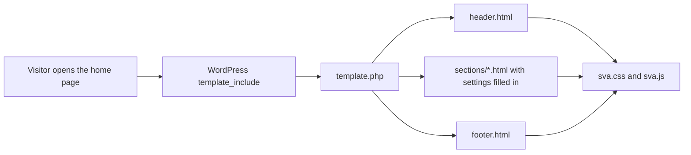
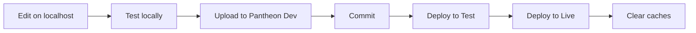

<div align="center">

# SalValAn Portfolio

### Build. Analyze. Document.

An animated one-page portfolio for three graduating BSIT students, built on WordPress, hosted on Pantheon and installable as an app.


**[Live site](https://dev-sal-val-an.pantheonsite.io/)** · **[Repository](https://github.com/javiernarn/Team-alpha-SalVanAn-portfolio-Cloud-Computing/tree/master)**

</div>

---

## The team

Each member owns one colour, one role and one part of the project cycle.

| | Role | Member | What they do |
| - | - | - | - |
| 🟠 | **Build** | Jonee John Antiquina | Programmer, Designer & Developer. Builds, designs and deploys the system |
| 🟢 | **Analyze** | Mariel Saldivar | Project Analyst. Gathers requirements and defines the system |
| 🟣 | **Document** | Diane Valle | Technical Writer. Writes the research and system documents |

## Highlights

- **One long page** with scroll-spy navigation, reveal animations and a progress bar
- **Dark and light themes**, saved per visitor
- **Skills & Services in one list**, filterable by member, with the skills shown as tags on each service
- **Project cards with screenshots**, filterable by member
- **Contact built in**: per-member cards, copy buttons, and a form that opens the visitor's email app
- **Installable PWA** with offline page and service worker
- **No build tools**: plain HTML, CSS, JS and PHP

---

## Projects

<table>
<tr>
<td width="50%" valign="top">

**ATMS, Alumni Tracing System**<br>
*Jonee · Laravel, MySQL*<br>
Alumni events, job posts, announcements and gallery.<br>
**Users:** alumni, event organizers, department heads, administrators


</td>
<td width="50%" valign="top">

**SCLF, Smart Campus Lost & Found**<br>
*Jonee · Laravel, React*<br>
Lost and found items, matching, claims, incidents, service requests and QR visitor badges.<br>
**Users:** students, instructors, security officers, administrators, visitors


</td>
</tr>
<tr>
<td width="50%" valign="top">

**OCCDL, OCC Duty Log**<br>
*Jonee · Laravel, React, mobile app*<br>
Digital Daily Time Record for OJT. Real-time hours per host client and a signable PDF report.<br>
**Users:** OJT trainees, OJT coordinators


</td>
<td width="50%" valign="top">

**A & K Car Tint and Accessories Service**<br>
*Mariel and Diane · Capstone*<br>
Web and mobile management system with OTP sign-in.<br>
**Web:** owner and admin · **Mobile:** customers and staff


</td>
</tr>
</table>

---

## Project structure

```text
.
├── README.md
└── salvalan-portfolio/
    ├── salvalan-portfolio.php
    ├── template.php
    ├── parts/
    │   ├── header.html
    │   └── footer.html
    ├── sections/
    │   ├── home.html
    │   ├── about.html
    │   ├── services.html
    │   ├── projects.html
    │   ├── experience.html
    │   └── contact.html
    └── assets/
        ├── css/sva.css
        ├── js/sva.js
        ├── fonts/
        │   ├── space-grotesk-latin-wght-normal.woff2
        │   └── manrope-latin-wght-normal.woff2
        └── img/
            ├── jonee.jpg
            ├── mariel.jpg
            ├── diane.jpg
            ├── atms-home.jpg
            ├── occdl-home.jpg
            ├── sclf-home.jpg
            ├── ak-admin-web.jpg
            ├── ak-mobile-home.jpg
            ├── ak-mobile-login.jpg
            ├── icon-192.png
            ├── icon-512.png
            ├── icon-maskable-512.png
            └── apple-touch-icon.png
```

`salvalan-portfolio/` is the project folder. It goes in `wp-content/plugins/`.

### How a page is built



The site joins every file in `sections/` (in the order set by `SVA_SECTIONS`), stores the result as the WordPress page named **Home**, and renders it with its own template so the theme never interferes. When `SVA_VER` changes, the Home page rebuilds itself the next time an admin opens wp-admin.

| File | Responsibility |
| - | - |
| `salvalan-portfolio.php` | Settings schema, `{{placeholder}}` filling, Home page build, redirects, asset loading, PWA routes, settings page |
| `template.php` | Replaces the theme template for the portfolio page |
| `assets/css/sva.css` | Design tokens, dark and light themes, layout, animations |
| `assets/js/sva.js` | Theme toggle, scroll-spy, reveal, drawer, filters, copy buttons, contact form, install button, service worker |

**Brand colours**

| Token | Light | Dark |
| - | - | - |
| `--build` | `#E8431A` | `#FF6A3D` |
| `--analyze` | `#007F73` | `#2DD4BF` |
| `--doc` | `#5B45E0` | `#9C8BFF` |
| `--bg` | `#F3EEE4` | `#0B0B0F` |

---

## Setup: localhost to live



### 1. Edit on localhost

You need [LocalWP](https://localwp.com/) (free) and a code editor such as VS Code.

1. In LocalWP, create a WordPress site (for example `sal-val-an`) and start it.
2. Click **Go to site folder**, open `app/public/wp-content/plugins/`, and copy the `salvalan-portfolio/` folder into it.
3. Open **WP Admin**, go to the **Plugins** menu, and activate *SalValAn Portfolio*. The Home page is created automatically.
4. Go to **Settings → Permalinks** and choose **Post name**.
5. Go to **Settings → SalValAn** and fill in your details.
6. Go to **Pages → Home → Edit** to change the content (see **Editing content** below), press **Update**, and reload the local site to check it.

> The install-as-app button may not show on a `.local` address because browsers require HTTPS. Test that on the live site.

### 2. Go live on Pantheon

You need a Pantheon WordPress site with **Dev**, **Test** and **Live** environments.

1. In the Pantheon dashboard, open **Dev** and set the connection mode to **SFTP**.
2. Upload `salvalan-portfolio/` to `wp-content/plugins/` on Dev.
3. In Dev's wp-admin, activate *SalValAn Portfolio*, set **Permalinks** to **Post name**, and fill in **Settings → SalValAn**.
4. Open the **Code** tab in the dashboard and **Commit** the changes.
5. Deploy **Dev → Test**, check the site, then deploy **Test → Live**.
6. Use **Clear Caches** on every environment you deployed to.

**Updating later:** change and test on localhost, upload any changed image or style files to Dev, repeat your Edit page changes on Dev's **Pages → Home → Edit**, commit, deploy Dev → Test → Live, and clear caches.

<details>
<summary><b>Using Git instead of SFTP</b></summary>

```bash
git clone <your Pantheon site Git URL> salvalan-site
cd salvalan-site
cp -r /path/to/salvalan-portfolio wp-content/plugins/
git add wp-content/plugins/salvalan-portfolio
git commit -m "Update SalValAn portfolio to 4.4.0"
git push origin master
```

Set Dev to **Git** mode first. The clone address is under **Connection Info**. The GitHub repository holds the project files, and Pantheon has its own separate Git repository for deploying.

</details>

<details>
<summary><b>Pantheon rules to remember</b></summary>

| Rule | Meaning |
| - | - |
| Test and Live are read-only for code | Change files in Dev (or a Multidev) and deploy upward |
| Code and content move separately | Deploys carry code up. Database and files can be cloned down from Live |
| One connection mode at a time | Commit SFTP changes before switching Dev to Git |
| Multidev | A copy of the site for trying changes safely |
| Caching | Pantheon's CDN caches pages, so clear caches after every deploy |
| HTTPS | Needed for the installable app. On a custom domain, enable HTTPS and set `enforce_https: full` in `pantheon.yml` |

</details>

---

## Configuration

Open **Settings → SalValAn** in wp-admin.

| Field | Used for | Default |
| - | - | - |
| Jonee's email | Contact section (hidden if empty) | empty |
| ATMS live link | ATMS button in Projects | `https://alumniappv2.ethiodeploy.app` |
| OCCDL live link | OCCDL button in Projects | `https://antiquina-ota.ethiodeploy.app` |
| SCLF live link | SCLF button in Projects | `https://sclfapp.ethiodeploy.app` |
| Year ATMS was built | Experience timeline | "Earlier project" |
| Team project name | Projects section | SalValAn Cloud Portfolio |
| Team story / Mission | About section | built-in text |
| Contact form shortcode | Replaces the built-in email form (optional) | empty |

## Editing content

Content is edited on the **Edit page** screen in wp-admin, on localhost first and then on Pantheon Dev.

**To edit the page**

1. In wp-admin, go to **Pages → Home** and click **Edit**.
2. Click the **Custom HTML** block that holds the page.
3. Change the text you want, for example a project description, a skill tag or an experience entry. Keep the HTML tags around the text as they are.
4. Click **Update**, then open the site and reload to check it.

Project links, Jonee's email, the team story and the mission are changed in **Settings → SalValAn** instead.

| To change | Where |
| - | - |
| Text, skills, services, projects, experience, contact details | **Pages → Home → Edit** |
| Project links, Jonee's email, team story, mission, project name | **Settings → SalValAn** |
| Photos and screenshots | Replace the file in `assets/img/` with one of the same name |
| Colours and layout | `assets/css/sva.css` |

> **Edits made in Edit page are replaced** when you press **Rebuild Home page** or when the version number changes, because the page is rebuilt from the section files. They are also saved in the database, and deploying on Pantheon moves code only, so repeat them on Dev's **Pages → Home → Edit** before deploying.

Image sizes: team photos are 480×480 JPG (face near the top centre), project screenshots are about 1280 px wide. Customer names, emails and phone numbers in `ak-admin-web.jpg` are blurred, so keep them blurred if you replace it.

---

## Installable app (PWA)

The site serves `/salvalan-manifest`, `/salvalan-sw` (service worker) and `/salvalan-offline`. The **Install the app** button in the menu and footer appears when the browser reports the site as installable. On iPhone it always shows and explains Share → Add to Home Screen.

## Troubleshooting

<details>
<summary><b>The install button does not appear on Android</b></summary>

1. Open the site in **Chrome**, not inside Messenger, Facebook or another app's browser.
2. Confirm the site uses **HTTPS**.
3. Open `/salvalan-manifest` and `/salvalan-sw` on the phone. The first should show JSON and the second JavaScript. A 404 or blank page means SalValAn Portfolio is inactive or a cache or security plugin is blocking it.
4. Clear the Pantheon cache and reload.
5. If it was installed or dismissed before, Chrome may wait. Use Chrome's menu ⋮, then **Install app**.

</details>

<details>
<summary><b>Other common problems</b></summary>

| Problem | Fix |
| - | - |
| Old design, photos or service worker still show | Clear the Pantheon cache, then hard-reload |
| A section file was edited but nothing changed | Press **Rebuild Home page** in Settings → SalValAn |
| My Edit page changes disappeared | Rebuild Home page replaces them. Edit again, and avoid pressing Rebuild afterwards |
| Address bar shows `?page_id=` | Set Permalinks to **Post name** |
| Contact form opens the email app | Intended. Use a form shortcode for a server-side form |

</details>

---

<div align="center">

Built by **SalValAn** as a Cloud Computing final project · Opol Community College

</div>
